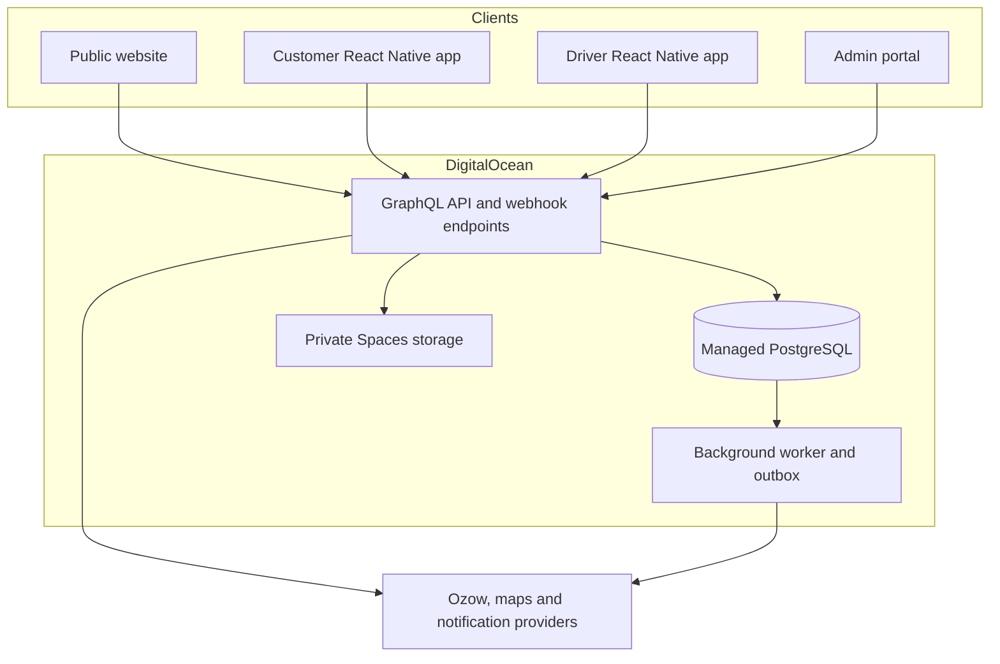

# Log-A-Load

A South African logistics platform connecting customers who need goods transported with vehicle owners and drivers.

**Company:** Log-A-Load (Pty) Ltd  
**Registration:** 2023/996751/07  
**Base:** Mdantsane, East London, Eastern Cape, South Africa  
**Brand line:** WHEN NO-ONE ELSE IS AROUND  
**Bookings:** bookings@log-a-load.co.za  
**Accounts:** accounts@log-a-load.co.za

## 1. Project scope and current status

This README describes both the **website that exists today** and the **proposed end-to-end platform**. Planned components are specifications, not deployed functionality.

| Component | Status | Purpose |
| --- | --- | --- |
| Public introduction website | Implemented | Introduce the app, explain customer/driver journeys, describe transport services and collect email enquiries |
| React app-screen walkthroughs | Implemented | Interactive illustrations of planned registration, pickup, destination and load-request flows |
| Apollo Client and GraphQL Code Generator | Configured, API not connected | Connect the website to a future GraphQL backend |
| Customer mobile app | Planned: React Native | Customer accounts, load requests, bookings, payments and delivery updates |
| Driver mobile app | Planned: React Native | Driver onboarding, vehicle details, approval, job acceptance and delivery updates |
| Admin operations portal | Planned | Driver verification, booking oversight, payments, disputes and support |
| Backend, database and file storage | Planned | Authoritative business logic, persistence and integrations |
| DigitalOcean infrastructure | Target architecture; not provisioned by this repository | Production web/API hosting, database, object storage and operational services |
| Ozow integration | Planned; not connected | Customer payment collection, subject to merchant approval and the agreed payment model |

The website currently opens an email draft. It does not store enquiries in a database, register drivers, upload documents, accept payments, create bookings or perform live tracking. The app screens and route maps are illustrative. There are no published mobile apps in this repository.

The existing review deployment uses Sites. **DigitalOcean (DO) is the agreed infrastructure destination**, and a migration is still required. No DO resources or production domains have been configured by this implementation.

## 2. Product experience

### Customer journey

1. Register or sign in and verify contact details.
2. Select a pickup address and destination, with location pins and collection instructions.
3. Describe the load: category, quantity, dimensions/weight where needed, photos and collection date.
4. Review vehicle suitability, availability, price and cancellation conditions.
5. Confirm the booking and complete payment according to the agreed booking/payment sequence.
6. Receive driver and vehicle details after assignment.
7. Follow booking status, collection and delivery updates.
8. Confirm receipt, view booking history and request support where necessary.

### Driver journey

1. Create a driver profile with contact details and operating area.
2. Add vehicle details and submit the documents required by the final onboarding policy.
3. Track the review outcome and respond to requests for corrections.
4. Review the driver agreement, fees and payout terms before joining.
5. Once approved, set availability and review suitable load requests.
6. Review pickup, destination, load requirements and earnings information before accepting.
7. Update arrival, collection, transit and delivery milestones.
8. Submit proof of delivery, view the earnings ledger and track payout status.

Document examples for planning include identity, driving licence, vehicle registration and vehicle photos. Final requirements and eligibility rules must be agreed with the business before implementation.

### Admin and support journey

- Review driver/vehicle applications and record approval or rejection reasons.
- Manage service areas, vehicle categories and pricing rules.
- Monitor bookings, assignment, cancellations and delivery exceptions.
- Reconcile customer payments and driver payouts.
- Handle refunds, disputes, document corrections and support cases.
- Review audit logs, operational reports and failed background jobs.

The driver onboarding pattern is comparable to a guided ride-hailing registration experience. Log-A-Load remains its own service; the design does not imply an Uber partnership.

## 3. Technology decisions

| Area | Selected or proposed stack | State |
| --- | --- | --- |
| Website | React 19, TypeScript, Vite 6, Yarn Classic 1.22.22 | Implemented; exact versions are recorded in yarn.lock |
| UI and motion | CSS, IntersectionObserver, React Icons (Feather icons) | Implemented; reduced-motion support included |
| GraphQL client | Apollo Client 3, GraphQL 16 | Installed; provider enabled only when an endpoint is configured |
| API type generation | GraphQL Code Generator, client preset | Configured; requires the actual backend schema |
| Mobile applications | React Native + TypeScript | User-selected; apps not scaffolded |
| Mobile navigation | React Navigation | Proposed; select versions when scaffolding |
| Backend | Node.js + TypeScript, Koa, Apollo Server | Proposed, consistent with the GraphQL frontend direction |
| Data layer | Prisma + PostgreSQL | Proposed; schema and migrations not created |
| Infrastructure | DigitalOcean | User-selected |
| Web/API hosting | DO App Platform | Proposed MVP hosting path |
| Database | DO Managed PostgreSQL | Proposed |
| Uploads | DO Spaces, private objects with controlled access | Proposed |
| Payments | Ozow | Planned; merchant application/integration outstanding |
| Location services | Maps, geocoding and routing provider | To be selected |
| Notifications | Push via APNs/FCM; email/SMS providers | To be selected |

React Native framework choice (for example, Expo versus direct native projects) is still open. Evaluate background location, maps, document capture, push notifications and build requirements before deciding. Do not treat the website's dependency versions as a mobile compatibility matrix.

## 4. System architecture



This is the **target design**. The current website makes no booking/payment API requests. Use HTTPS for clients and provider callbacks. Restrict database access to approved application services; clients never connect directly to PostgreSQL.

Start with a modular backend and a worker rather than independent microservices. Use a transactional outbox in PostgreSQL for durable notification/payment follow-up jobs. Introduce a dedicated queue/cache only when workload and reliability requirements justify it.

## 5. Repository structure

### Current repository

```text
log-a-load/
  public/
    logo.svg
    images/customer-driver.webp
  src/
    components/           # Website sections and illustrative app screens
    hooks/useMotion.ts    # Scroll reveals and reduced-motion handling
    lib/apollo.ts         # Conditional Apollo Client setup
    graphql/              # Location for future real GraphQL operations
    App.tsx
    main.tsx
    styles.css
    useWebsiteInteractions.js
    useWebsiteInteractions.d.ts
  .env.example
  .gitignore
  .yarnrc
  codegen.ts
  index.html
  package.json
  tsconfig.json
  vite.config.ts
  yarn.lock
  README.md
```

`src/gql/` will be generated when a schema and operations are available. The hosted checkout also contains `.openai/hosting.json` for its current Sites identity. It is not a DigitalOcean configuration and is excluded from the portable project ZIP.

### Proposed full-platform layout

```text
apps/
  website/                # Existing website moved here in a future migration
  customer-mobile/        # React Native customer application
  driver-mobile/          # React Native driver application
  admin/                  # React admin portal
  api/                    # Koa/Apollo backend
  worker/                 # Durable background processing
packages/
  graphql/                # Schema/contracts and generated operation types
  domain/                 # Shared pure types and validation contracts
  config/                 # Shared TypeScript/lint configuration
infra/
  digitalocean/           # App specs and infrastructure definitions
  runbooks/               # Deploy, rollback, restore and incident procedures
```

This monorepo does not exist yet. Browser DOM components cannot be imported directly into React Native. Share API contracts and pure business utilities, while using platform-appropriate UI and secure storage.

## 6. Run the current website locally

Use a supported Node.js release compatible with the pinned tooling. The existing production build was verified using Node.js 24.22.1. The project pins Yarn Classic 1.22.22 through `packageManager`.

```bash
cd log-a-load
corepack enable
corepack yarn install --frozen-lockfile
corepack yarn dev
```

If Yarn is already installed, `yarn install --frozen-lockfile` and `yarn dev` are equivalent. If Corepack is unavailable, install it using the supported procedure for your Node environment. `node_modules` is intentionally excluded from the download.

Open the local address printed by Vite. Use the following commands from the current repository root:

| Command | Result |
| --- | --- |
| `yarn dev` | Starts the Vite development server |
| `yarn build` | Runs the TypeScript build check and emits production files to dist/ |
| `yarn preview` | Previews the production build locally; run yarn build first |
| `yarn codegen` | Generates typed GraphQL documents from a configured schema |
| `yarn codegen:watch` | Watches schema/operation inputs for regeneration |

The development configuration allows `terminal.local` for the managed preview. Keep explicit host restrictions if adding another preview hostname. Production uses the built `dist/` files, not the Vite development server.

## 7. Website environment and GraphQL

The marketing site runs without an `.env` file or backend connection. To configure a real API:

```bash
cp .env.example .env
```

```dotenv
VITE_GRAPHQL_URL=https://api.example.com/graphql
GRAPHQL_SCHEMA=./schema.graphql
```

The hostname is illustrative. Set the real endpoint before enabling API-backed functionality. `GRAPHQL_SCHEMA` may be a schema file or URL; if unset, codegen falls back to `VITE_GRAPHQL_URL`.

1. Obtain the backend's actual SDL/introspection schema or an authorised schema endpoint.
2. Set `GRAPHQL_SCHEMA` or `VITE_GRAPHQL_URL`.
3. Add real `.graphql` or `.gql` operation documents under `src/graphql/`.
4. Run `yarn codegen`.
5. Import the generated typed documents from `src/gql/` and use them with Apollo.
6. Run `yarn build` and verify API-backed flows against the correct environment.

The codegen config scans `src/**/*.{graphql,gql}` and generates the client preset into `src/gql/`. No schema or sample business operations are bundled. Running codegen without a configured schema deliberately fails with an explanatory message. `ignoreNoDocuments` permits an initially empty operation directory; it does not supply a backend.

**All VITE_ variables become public browser configuration.** Never place database URLs, Ozow secrets, signing keys, object-storage credentials or notification credentials in them. Mobile app bundles are also public clients; provider secrets belong on the backend.

## 8. Planned backend modules and data model

| Module | Responsibilities | Main proposed records |
| --- | --- | --- |
| Identity | Authentication, verification, roles, sessions | User, Role, Session, VerificationChallenge |
| Driver onboarding | Profile review and approval | DriverProfile, DriverApplication, ReviewDecision |
| Vehicles/documents | Vehicle suitability and private evidence | Vehicle, Document, DocumentReview |
| Bookings | Pickup, destination, load and agreed price | Booking, LoadItem, AddressSnapshot, Quote |
| Assignment | Offer expiry and atomic acceptance | Assignment, JobOffer |
| Delivery | Milestones, location and proof | BookingEvent, LocationUpdate, ProofOfDelivery |
| Payments | Collection, verification and reconciliation | Payment, PaymentEvent, Refund |
| Earnings/payouts | Driver liability and disbursement tracking | LedgerEntry, Payout, PayoutAttempt |
| Support | Exceptions, disputes and communication | SupportCase, Dispute, Notification |
| Operations | Traceability and durable work | AuditEvent, OutboxJob |

Use UUIDs or equivalent opaque identifiers, timestamps and explicit state transitions. Snapshot addresses and accepted prices on bookings so later edits do not rewrite transaction history. Store monetary values in integer minor units plus currency. Keep file metadata in PostgreSQL and bytes in Spaces.

Suggested booking lifecycle, to be confirmed with the business:

`DRAFT -> REQUESTED -> CONFIRMED -> ASSIGNED -> PICKUP_ARRIVED -> COLLECTED -> IN_TRANSIT -> DELIVERED -> COMPLETED`

Cancellation and exception transitions must be defined for each applicable state. Maintain payment and payout lifecycles separately from the booking lifecycle. Driver approval is also separate from account creation.

### API boundaries

GraphQL is proposed for authenticated application operations. Example operation names such as `createLoadRequest`, `acceptJobOffer`, `submitDriverApplication` and `recordDeliveryMilestone` are design placeholders, not existing API fields.

Keep provider callbacks and health checks as dedicated HTTP endpoints. Implement server-side validation, authorisation, rate limits, pagination and request correlation. Add a versioned schema/codegen process; changing a schema must not silently break older released mobile clients.

## 9. Payment and driver payout design

The public site must not imply that payments are enabled or that merchant approval is guaranteed.

Planned payment flow:

1. The backend calculates the payable amount from an approved pricing rule or accepted quote.
2. Create a pending payment with a unique reference and a link to the booking.
3. Initialise payment through the provider from the backend.
4. Send the customer to the supported payment flow.
5. Validate callback authenticity and verify transaction state using the provider's current integration specification.
6. Compare reference, amount and currency with the server-side record.
7. Apply each provider event once, using a unique event/reference constraint and transactional processing.
8. Reconcile pending or uncertain transactions with a background job.
9. Issue receipts and update the booking only after the required payment state is confirmed.

A browser redirect or mobile success screen is not payment evidence. Refunds and payouts require authorised backend workflows, auditable records and reconciliation. Driver payouts are a separate integration/workstream: do not assume that an Ozow collection account automatically provides disbursements or marketplace split settlements.

### Business rules still requiring confirmation

The supplied launch material mentions the following, but it does not define enough detail to implement them safely:

| Item | Decision needed |
| --- | --- |
| 83/17 split | Recipient of each share, calculation base, fees, taxes and refunds |
| R1,500 retainer | Who pays, frequency, purpose and refund conditions |
| R200 wallet minimum | Whose balance, allowed funds movement and enforcement rules |
| 24-hour driver pay | Trigger, verification requirements, exceptions and operational funding |
| First load free | Funding source, eligibility, monetary cap and exclusions |
| All nine provinces | Launch coverage versus future expansion |
| Pricing | Distance/load/time rules, quote acceptance and price-change behaviour |
| Cancellations/refunds | Cut-off points, charges, refund route and support handling |

Do not add a wallet or automate split payments until the operating model and applicable provider requirements have been confirmed. Do not interpret marketing copy as an executable payment policy.

## 10. React Native mobile delivery

Build customer and driver experiences with React Native and TypeScript. Separate app binaries are the proposed default so permissions and release cycles can differ; confirm this product decision before scaffolding.

### Shared capabilities

- GraphQL operations/types generated from the actual backend schema.
- Authentication with platform secure storage for credentials/session material.
- Address search, location pins and route summaries through the chosen maps provider.
- Permission-aware camera/photo uploads through authorised upload sessions.
- Push notifications, deep links and booking history.
- Offline-aware screens, reconnect recovery and idempotent retry behaviour.
- Accessible navigation and appropriate loading/error states.

### Driver-specific capabilities

- Document submission, resubmission and review status.
- Vehicle information and availability controls.
- Job offers with expiry and server-enforced single-driver acceptance.
- Active-job status updates and proof of delivery.
- Location sharing limited to the agreed active-job policy, with explicit permissions and clear user controls.
- Read-only earnings/payout history backed by the server ledger.

### Build and release prerequisites

Android native builds require the relevant Android SDK/JDK tooling. Native iOS builds require Apple's macOS/Xcode tooling. DO hosts the application services; it is not the iOS build machine. Use a macOS CI runner or an approved managed mobile build service for iOS. App Store Connect and Google Play developer accounts, bundle identifiers, signing credentials and release policies must be set up separately.

No `yarn android`, `yarn ios` or mobile build commands exist in the current repository. Add the actual commands to each app's documentation after scaffolding and framework selection.

## 11. DigitalOcean infrastructure plan

### MVP deployment topology

| Resource | Purpose | Deployment notes |
| --- | --- | --- |
| App Platform static site | Public Vite website | Build dist/; serve static output |
| App Platform static site | Future admin portal | Separate deployment and API-enforced admin permissions |
| App Platform web service | GraphQL API and provider callbacks | Runtime secrets, HTTPS, health checks and controlled database access |
| App Platform worker | Outbox processing, reconciliation and notifications | Idempotent jobs, retries with backoff and failed-job visibility |
| Managed PostgreSQL | Transactional business data | Restricted connections, TLS, backups and least-privilege roles |
| Spaces | Driver documents, load photos and delivery proof | Private objects by default; short-lived signed access |
| DNS/domain configuration | Public web/API hostnames | Client-owned domains and verified TLS configuration |
| Logs/alerts | Operations | Alert routing, retention policy and correlation identifiers |

Use separate staging and production applications, databases, buckets/Spaces and credentials. A frontend origin is not a security boundary: all sensitive actions require backend authorisation.

Select an available DO region that supports the required services together; test latency from South Africa and review the business's data-location requirements. Do not assume DO offers a South African region. Region, instance sizes, redundancy and costs are decisions to make during provisioning, not resources already established here.

App Platform, Managed Databases and Spaces availability varies. Verify current availability before selecting a region. The database and file store must be durable services; do not store business files on the API container filesystem.

### Deploy the current website on App Platform

1. Push this repository, including `yarn.lock`, to the client-owned Git provider supported by the chosen DO workflow.
2. Create an App Platform app and connect the desired repository/branch.
3. Configure the component as a **Static Site**.
4. For this current repository, use the repository root as the source directory.
5. Use `corepack yarn install --frozen-lockfile && corepack yarn build` as the build command, with a build environment that supplies Corepack/Yarn Classic. If the selected buildpack installs dependencies automatically, verify its logs and use `corepack yarn build` after that installation.
6. Set the output directory to `dist`.
7. Leave `VITE_GRAPHQL_URL` unset until a working API is available. When used, set it as a build-time value and rebuild on changes.
8. Deploy and smoke-test the app journey controls, images, enquiry links and legal dialogs.
9. Add the client-owned domain and apply the DNS records supplied by DO.
10. Verify HTTPS, root-domain/subdomain routing and the support email addresses.
11. Once the DO site is verified, update any review/share links and document the cutover.

The website currently uses anchors on one page. If client-side routed pages are added later, configure the SPA fallback to `index.html` and verify direct navigation/reloads. Do not route missing asset files to an HTML document without checking the resulting behaviour.

### Backend provisioning sequence (future)

1. Create staging resources and isolated service identities.
2. Provision PostgreSQL and private object storage.
3. Configure API secrets outside source control.
4. Deploy the API and worker with health checks.
5. Run reviewed schema migrations from a controlled release job with database connectivity.
6. Connect the website/admin/mobile staging clients.
7. Configure provider test credentials and externally reachable callback endpoints.
8. Verify end-to-end booking, payment and onboarding flows.
9. Provision production separately and repeat the release checklist.

No Terraform, DO app spec, Dockerfile or migration scripts are included yet. Add these as reviewed implementation deliverables. Never paste illustrative infrastructure settings into production without replacing and validating them.

## 12. Configuration and access

Current website variables are only `VITE_GRAPHQL_URL` and `GRAPHQL_SCHEMA`. The following are **future backend configuration categories**, not currently supported environment keys:

- Database connection and migration credentials.
- Authentication/session signing material and expiry policy.
- Spaces endpoint, bucket and least-privilege credentials.
- Ozow merchant configuration and provider secrets.
- Maps/geocoding server keys and client-restricted public keys.
- Email/SMS/push provider credentials.
- Web/mobile origins, deep-link identifiers and callback URLs.
- Log/monitoring configuration and environment identifiers.

Use client-owned accounts with named access and MFA where available. Keep credentials in the hosting/CI secret stores. Store `.env` locally only; `.env.example` contains placeholders. Do not reuse staging provider credentials in production.

## 13. Security, privacy and operational controls

Implementation requirements:

- Enforce customer ownership checks, driver approval and admin role checks on every protected API operation.
- Require stronger authentication for administrators and sensitive account/payout changes.
- Validate all state changes server-side; never trust client prices or job-approval flags.
- Use private upload access, file-type/size validation, malware scanning/quarantine and controlled document access.
- Redact secrets, identity data, precise location and financial details from routine logs.
- Define retention/deletion rules for onboarding documents, location history and proof of delivery.
- Maintain audit records for approvals, price changes, refunds, payouts and privileged actions.
- Validate webhook replay protection and idempotency.
- Define backup retention, restore procedures and ownership; test restoration before launch.
- Keep user-facing privacy, service and refund policies aligned with the implemented product and actual providers.

The current website is an introduction site with an email-draft form. These requirements apply as real account, upload, payment and tracking services are introduced. Legal/privacy policies need business review before production use; this README is an engineering plan, not a legal opinion.

## 14. CI/CD and release workflow

### Current checks

- `yarn build`: TypeScript build check and Vite production bundle.
- ZIP integrity verification for downloadable source exports.
- Manual browser checks performed for visual layout, walkthrough controls and selected dialogs.

There is no automated test suite, lint script or CI pipeline in the current repository. Do not claim unit, integration, mobile or payment tests have passed.

### Proposed pull-request pipeline

1. Install with `yarn install --frozen-lockfile`.
2. Run formatting/lint checks once those tools are added.
3. Regenerate GraphQL types against the controlled schema once actual operations exist; reject unexpected generated changes.
4. Run TypeScript checks, unit/component tests and production builds.
5. For backend changes, run integration tests against isolated test infrastructure.
6. Run relevant browser/mobile smoke tests and report results.
7. Review dependency/security findings and block material unresolved issues according to the team's policy.
8. Deploy a staging build from the reviewed commit.

Production releases use an approved version/commit and a recoverable deployment. Stage compatible database changes before clients that require them. Preserve API compatibility for mobile versions already in users' hands. Do not couple database migration success to a static website build.

### Mobile pipeline

Build Android and iOS independently with signing material in protected secret storage. Run emulator/simulator checks, then device tests for permissions, background/resume behaviour, network changes and uploads. Release through internal testing channels before staged public rollout.

## 15. Test strategy for the complete platform

| Area | Critical coverage |
| --- | --- |
| Website | Responsive layout, keyboard access, reduced motion, image loads, journey switching, contact links, form validation |
| Customer app | Registration, location selection, load data, quotes, booking updates, cancellations and support |
| Driver app | Document review/resubmission, vehicle approval, job offers, acceptance race conditions, pickup/delivery evidence |
| API | Authorisation, schema contracts, validation, pagination, idempotency and permitted state transitions |
| Payments | Callback authenticity, duplicate events, wrong amount/reference, delayed success, failed/cancelled payment, reconciliation |
| Payouts | Correct driver liability, duplicates, failed attempts, manual review and reconciliation |
| Mobile devices | Android/iOS permission states, offline/reconnect, interrupted uploads, deep links, notification handling and background behaviour |
| Infrastructure | TLS, restricted database access, private file access, deploy rollback, backup restoration and alert delivery |

Use provider sandboxes and synthetic data. Real-money tests, access to production identity documents and destructive production actions require a separately controlled operational process.

## 16. Monitoring, support and recovery

Define operational owners before launch. Monitor API error rate, latency, payment verification backlog, unassigned bookings, driver review backlog, failed uploads and worker retries. Use request/booking/payment correlation IDs across logs without exposing private customer data.

Write runbooks for failed payment verification, duplicate callback, stalled delivery, driver document rejection, lost device/session revocation and suspected account misuse. Payout/refund actions must have traceable authorisation.

For recovery, retain the last known-good application artifact, back up the database before risky changes, and use forward-compatible migrations. Do not automatically roll a database schema back with a frontend rollback. Agree recovery objectives and backup retention with the client, then validate them through restore drills.

## 17. Delivery phases and completion criteria

| Phase | Deliverables | Completion criteria |
| --- | --- | --- |
| 1. Introduction website | Branding, app explanation, customer/driver walkthroughs, contact and policy information | Responsive page verified; business content reviewed; DO deployment and domain cutover completed |
| 2. Platform foundation | Backend, identity, database, file access, staging infrastructure and admin access | Authorisation, migrations, backup/restore and API contracts verified |
| 3. Driver onboarding | React Native driver profile/vehicle/document flows and admin review | Submission, corrections, approval and private document access work end to end |
| 4. Customer booking | React Native customer app, route/load capture, pricing and assignment | A request progresses through approved booking/assignment transitions |
| 5. Payments and operations | Ozow collection, reconciliation, refunds, earnings/payout tracking | Provider requirements met; duplicates/failures covered; operations reconciles records |
| 6. Delivery and launch | Driver milestones, notifications, proof, support, device testing and store releases | Controlled pilot passes, runbooks owned, production policies approved and rollout monitored |

The present work covers much of the website implementation in Phase 1. DigitalOcean provisioning, business policy approval and production launch requirements remain outstanding. The app walkthroughs do not constitute Phase 3 or 4 implementation.

## 18. Decisions to close before backend/mobile build

- Confirm launch service area and vehicle categories.
- Approve customer pricing, cancellation and refund rules.
- Resolve the retainer, wallet, commission split and payout model.
- Confirm the exact driver document/verification requirements.
- Decide whether customer and driver apps ship as separate binaries.
- Select React Native framework/build workflow, maps provider and notification providers.
- Confirm backend framework, PostgreSQL/Prisma proposal and repository layout.
- Select DO region, production redundancy, backup retention and operating budget.
- Establish client-owned domain, DO, Git, app-store and payment-provider accounts.
- Assign support, finance, document review and incident owners.

## 19. Maintaining the website

- Website sections: `src/components/`.
- Interactive app journey content: `src/components/HowItWorks.tsx`.
- Driver registration guide: `src/components/Drivers.tsx`.
- App introduction image/content: `src/components/AppPreview.tsx`.
- Main styling: `src/styles.css`.
- Icons: import from `react-icons/fi`; use components instead of text symbols for UI icons.
- Motion: `src/hooks/useMotion.ts` and reduced-motion CSS.
- Email-draft/FAQ-policy interactions: `src/useWebsiteInteractions.js` and relevant section components.
- Brand assets: `public/logo.svg` and `public/images/`.

The customer/driver artwork is an illustrative generated asset, not a real employee/customer photograph. Do not use app mockups as proof that a feature has shipped. When a backend is introduced, replace the email-draft flow and update the privacy/terms content to match the actual data handling.

## 20. Official implementation references

Checked on 30 October 2026. Consult the current documents during implementation; service availability and toolchain requirements may change.

- [DigitalOcean: create apps and select component types](https://docs.digitalocean.com/products/app-platform/how-to/create-apps/)
- [DigitalOcean: manage static sites](https://docs.digitalocean.com/products/app-platform/how-to/manage-static-sites/)
- [DigitalOcean: persistent storage](https://docs.digitalocean.com/products/app-platform/how-to/store-data/)
- [DigitalOcean: regional availability](https://docs.digitalocean.com/platform/regional-availability/)
- [DigitalOcean: monorepo deployment](https://docs.digitalocean.com/products/app-platform/how-to/deploy-from-monorepo/)
- [React Native: development environment setup](https://reactnative.dev/docs/set-up-your-environment)

## 21. Ownership and distribution

Confirm repository access, code ownership, third-party licence obligations and handover terms with the client. No open-source licence or public redistribution permission has been selected for this project. Do not assume generated branding grants rights to third-party trademarks.
